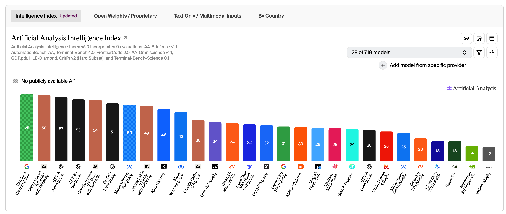

**背景导读：**

> 这个月的关键词是【开源与边界】。本月AI在模型、推理框架、Agent和理论突破上多线加速：DeepSeek以Flash、DeepInfer、Super-agent连续推进开源落地，Kimi、GPT-6.1、Gemini 4 Carbon把模型竞争重新推回白热化，OpenAI则用722篇数学手稿和三项基础科学突破把AI推向理论研究前沿。但另一面，国办发文减缓AI就业替代影响，强模型风险线、AI泡沫与失控风险也被反复讨论。加速仍在继续，边界正在被重新划定。

金句：桐花万里丹山路，雏凤清于老凤声。

# 资讯盘点 - 本月发生了什么

- 2026.10.04 | 马斯克将SpaceXAI再次更名为SpaceXSI，以“超级智能”替换“AI”表述。
- 2026.10.07 | Anthropic发布Claude Haiku 5.5，与Sonnet 5.5组成5.5代产品组合。
- 2026.10.07 | OpenAI公开722篇内部模型生成的数学手稿，含准黎曼猜想等成果，部分附Lean形式化证明。
- 2026.10.17 | DeepSeek V4.1 Flash更新至1017版，552B参数，主打高并发低延迟。
- 2026.10.20 | DeepSeek全面开源生产级推理框架DeepInfer，兼容英伟达与华为昇腾，旨在降低大模型部署成本。
- 2026.10.23 | 国办发文要求减缓AI应用就业替代影响，稳慎把握劳动密集型行业应用节奏并强化转岗支持。
- 2026.10.24 | 月之暗面发布Kimi K3.1 Pro，2.8万亿参数、100万Token上下文，智能指数居全球前四。
- 2026.10.26 | OpenAI宣布AI在数学、计算机科学、物理学取得三项突破，成果含挂谷猜想证明、推翻ETH与杨–米尔斯严格证明。
- 2026.10.26 | OpenAI发布GPT-6.1 Terra，定位高强度专业工作，输入定价较上代直降50%。
- 2026.10.27 | 英伟达与甲骨文将Vera Rubin NVL72扩至吉瓦级，Rubin平台首次以云端可租赁形态商用。
- 2026.10.28 | 谷歌DeepMind发布Gemini 4 Carbon，智能指数59重回全球第一，但暂未全量开放。
- 2026.10.28 | 谷歌DeepMind发布世界模型Genie 4，首个原生生成音频的实时交互世界模型。
- 2026.10.29 | 腾讯WorkBuddy披露上线7个月完成90亿次任务请求，企业版覆盖50%中国500强。
- 2026.10.31 | DeepSeek发布Super-agent架构，Router+Worker双层设计，实现跨会话连续、多任务并行与持久在线。

# 信息解读

- **DeepSeek开源。**本月DeepSeek从Flash 1017到推理框架DeepInfer再到Super-agent架构，在往全面开源的方向发展。除了模型外，另外两个工作也都是AI落地的关键问题。不过普惠也是双刃剑，模型被滥用产生的破坏也会变大。
- **AI应用节奏放缓。**AI的影响是巨大的，企业在没有扩大市场的情况下，降本增效势必会导致失业风险的增加。现在是最难也是最关键的时期，希望能平衡好生产力和社会影响。
- **理论研究前沿将由AI推进。**本月OpenAI先后公开的数百篇数学研究和三项突破。这对数学行业和理论研究方向的影响巨大。就像围棋那样，纯理论证明方面也已经进入到人学AI的阶段。

# AA榜单

> 上月我们没有更新，因为AA的评价标准时效性已经不够
>
> 本月变动较多。不过综合榜单现在作为参考即可，后续更多是关注具体场景使用

- Kimi K3国模一位，发布后因计费不正确问题发放了一周额度
- Gemini Carbon登顶一位，但还未提供公开API
- DeepSeek Flash 1017达到上轮旗舰模型水平，速度达到230/300 token/s

# 下个月关注点

- AI泡沫演化
- Fable 5.5模型
- GPT6.2模型
- Qwen4开源模型
- GLM新模型

# 个人洞察 - AI会走向何方

**国内算力芯片是否会走向自给？**

上月：千问/平头哥在国内对芯模协同进化的进展是最快的。观望是否有从零开始开始造芯的AI公司出现。

本月：尚没有出现从零开始造芯的AI公司。今年英伟达的显卡在国内已经涨了2~3倍，也变相佐证了国内算力芯片生态、产能、推广都还有差距。依然期待完成自给。

**强模型会开放吗？**【结】

上月：Astra模型已公布。白宫AI自律协议是政府开始公开介入的一个信号。风险的管控还是很难，需要在全球范围协作才有可能。

本月：目前来看模型已经远远跨过风险线了，强模型按照风险来定义的话已经开放了。后续就看如何管控风险了。

**是否会出现全新的市场？**

上月：本月没有看到新的市场。不过很多市场的颠覆已经可见，包括数学、建模、机器人、科普视频制作。

本月：谷歌发布了Genie 4。语言模型、视觉模型、世界模型这些模型的统一可能性是非常有趣的。本月出现了很多用dsh做直播的牟利行为，不过是短期的行为。

**AI泡沫会发生吗？**【新】

本月：会的，但不影响AI技术会继续演进。

**AI是朋友还是敌人？**【新】【结】

很多科幻作品中AI担任了反派的角色，也是美国想把AI改成SI的一个原因。资源的控制权是关键。能想到的几种风险形式

- 被不怀好意的人利用，造成难以遏制的破坏和影响。
- 大量应用AI，同时交出了部分资源的控制权。因为非人为刻意行为导致系统错误，导致产生大量影响。
- 超级智能完成越狱并形成分布式智能，控制大量资源并自我迭代。
- 实现AI+机器人的自迭代，形成物理面的威胁。

今年二三月的时候在考虑这个问题，我们还没有做好准备迎接这么强的智能，当时蛮希望能放缓步伐的。个人是更希望做一些专用的模型来创造价值的同时减少失控的风险。

# 总结

10月是一个“技术继续越界、规则开始设界”的月份。开源把落地门槛进一步压低，AI则越入数学与理论研究核心；但就业替代、强模型管控与泡沫风险同时显形。技术不会因泡沫停下，真正需要回答的是：越界之后，谁来定界。下月关注AI泡沫演化、Fable 5.5、GPT-6.2、Qwen4与GLM新模型。
